# Мобильное приложение — утверждённый редизайн (12 октября 2026)

Владелец утвердил эти экраны 12.10.2026. Документ — задание на внедрение в
`apps/mobile`. Картинки в `images/` — это макеты, а не скриншоты сборки.
Числа, номера заказов и составы на них — примеры.

Исходные макеты (холсты Claude Design, приватные, у владельца):
- Заказы и трекер: https://claude.ai/artifact/7QWJBjsamymoAX9tnuL4su
- Наши рестораны: https://claude.ai/artifact/NZcd5b3gVpQBvaDAiNR8Bd
- Галерея всех текущих экранов + вкладка «Утверждено»: https://claude.ai/artifact/PxTM2sh4AG94o6BVNMS2Qf

Общие правила для всех экранов:
- Палитра и шрифты — из `apps/mobile/src/theme.ts` и `packages/design-tokens`,
  новых цветов не вводить, кроме перечисленных ниже. Фон `#04143A`, поверхность
  `#0A2050`, поднятая поверхность `#123068`, текст `#F2F6FF`, вторичный `#93A6C9`,
  акцент `#FF6900` / `#FF8A3D`, успех `#ADEDD1`, предупреждение `#FFE2C3` на `#4B311D`.
- Деньги — через существующий `money()`; данные — только из текущих моделей
  (`CustomerCommerceOrder`, test-flow заказы, каталог, `config/restaurant-locations.json`).
- Не трогать бизнес-логику, контракты API и сценарии оплаты. Это задача по UI.
- Касания не меньше 44 pt, сохранять `testID` существующих элементов,
  добавлять `testID` новым и обновить тесты/скриншоты.

---

## 1. Запуск и вход — БЕЗ ИЗМЕНЕНИЙ

Сплэш `LaunchReveal`, `/auth` (приветствие, телефон, код, «Знакомимся», выбор
даты рождения) утверждены как есть. Ничего не менять.

---

## 2. «Наши рестораны» (M05, `screens/CatalogScreens.tsx` → `Branches`)

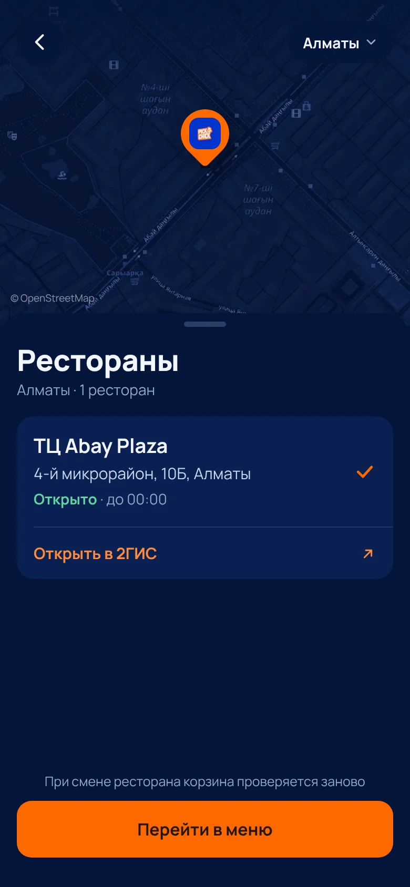 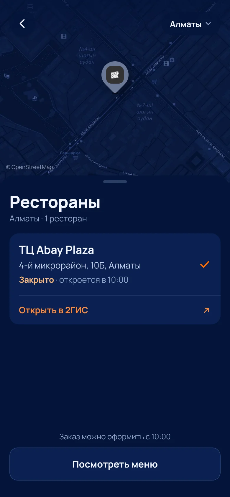

Было: 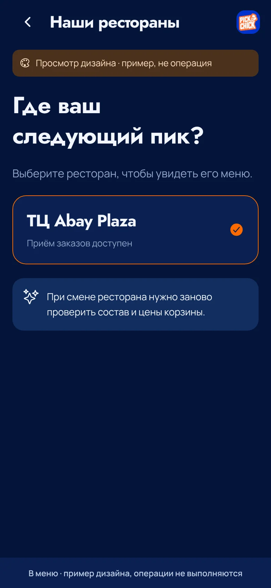

Структура сверху вниз:
1. **Карта** высотой ~320 pt на всю ширину, сверху. Метка ресторана — оранжевая
   «капля» с логотипом, у закрытого ресторана — серая. Поверх карты: слева
   круглая кнопка «назад» (44 pt, фон `rgba(4,20,58,0.88)`), справа выбор города
   «Алматы ▾» (пока один город — кнопка без списка или с одним пунктом).
   Координаты Abay Plaza: `43.226274, 76.860865` (из карточки 2ГИС).
   Карта: решить — 2ГИС MapGL/SDK (нужен ключ) или `react-native-maps`. Пока нет
   решения — допустима статичная картинка карты с атрибуцией © OpenStreetMap.
   Добавить `latitude`/`longitude` в `config/restaurant-locations.json`.
2. **Шторка** под картой (наезжает на карту на ~22 pt, скругление 24 сверху,
   «ручка» 40×5): заголовок «Рестораны» (Manrope 800, 28), строка
   «Алматы · 1 ресторан» (вторичный цвет).
3. **Один блок** (`#0A2050`, радиус 16), без подписей «Адрес», «Часы работы»,
   «Получение» — владелец явно попросил их не писать:
   - строка-кнопка выбора: название (Manrope 700, 19), адрес одной строкой
     «4-й микрорайон, 10Б, Алматы», статус: `Открыто` зелёным `#5FD3A0` + « · до 00:00»
     или `Закрыто` `#FFB777` + « · откроется в 10:00». Справа тонкая оранжевая
     галочка у выбранного ресторана. **Без оранжевой обводки карточки, без фото.**
   - разделитель 1 px `#1E3563` с отступом слева 16;
   - строка «Открыть в 2ГИС ↗» (оранжевый текст). Должна открывать **приложение
     2ГИС**: сначала `dgis://2gis.ru/geo/70030076952394244`
     (через `Linking.canOpenURL`/`openURL`), при неудаче — `map_url` из конфига
     (https://2gis.kz/almaty/geo/70030076952394244). Для iOS добавить `dgis` в
     `LSApplicationQueriesSchemes`.
4. Внизу: мелкая подпись «При смене ресторана корзина проверяется заново» и
   кнопка «Перейти в меню» (54 pt, радиус 14, `#FF6900`, текст `#251609`).
   Если закрыто: подпись «Заказ можно оформить с 10:00» и вторичная кнопка
   «Посмотреть меню» (фон `#0A2050`, рамка `#2A4378`).

Статус считать по `opening_time`/`closing_time` из конфига и времени Asia/Almaty
(00:00 = полночь, закрытие после полуночи учитывать). Экран для нескольких
точек не делаем (владелец убрал); список просто повторяет блок для каждой точки.

---

## 3. Вкладка «Заказы» (M19, `ConnectedHistory` в `screens/ConnectedOrderScreens.tsx`, `History` в `OrderScreens.tsx`, `components/OrderHistoryCard.tsx`)

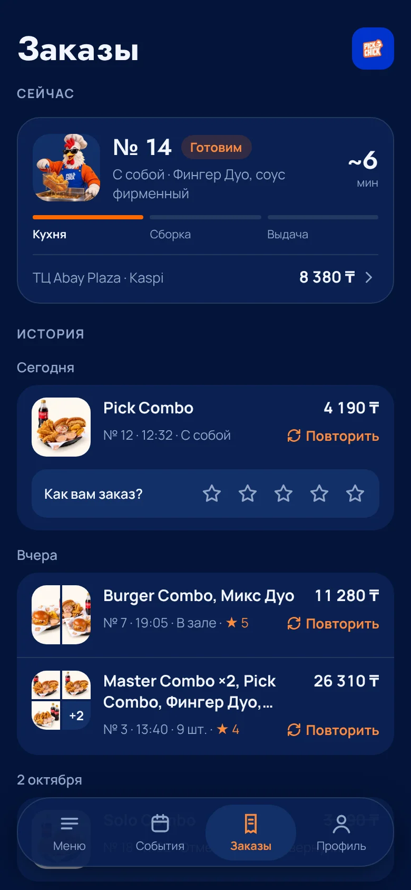 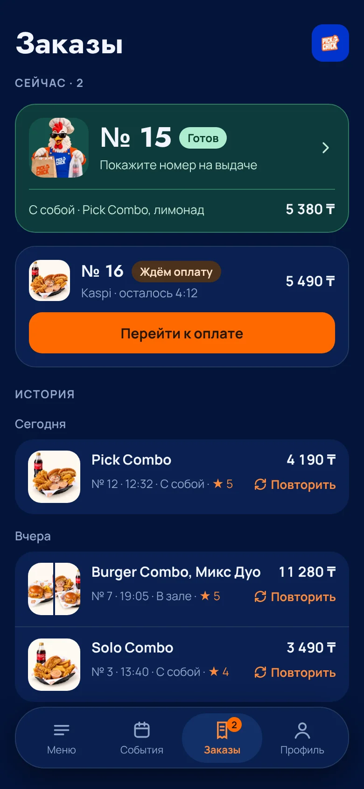
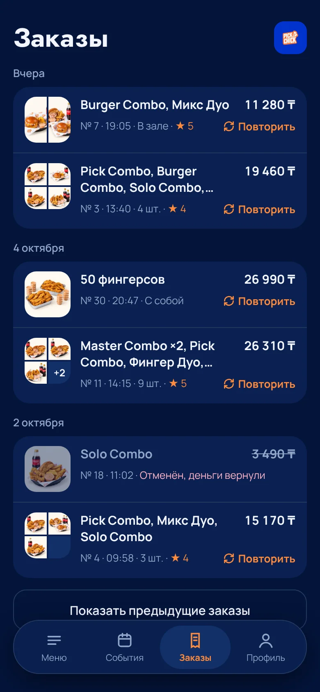 

Было: 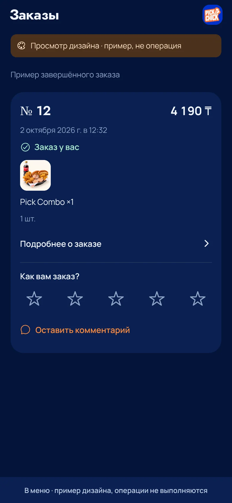

Цель — компактность: на экран помещается активный заказ и ~5 заказов истории.

**Заголовок:** «Заказы» (Jost 700, 32) + логотип 40×40 справа.

**Секция «Сейчас»** (подпись 12, uppercase, `letter-spacing .08em`; при 2+ — «Сейчас · 2»):
- Карточка активного заказа (`#0A2050`, рамка `#233962`, радиус 22, отступ 14), вся — кнопка в трекер:
  - слева плитка 64×64 (`#123068`, радиус 16) со сценой шефа текущего этапа (те же картинки `order-status/*`);
  - «№ 14» (Jost 600, 22) + бейдж этапа («Готовим» оранжевый на `rgba(255,105,0,.16)`);
  - строка: способ получения · состав (до 2 строк);
  - справа ETA «~6 / мин», если есть данные; если нет — не показывать;
  - 3 полоски этапов «Кухня / Сборка / Выдача» (4 pt, активные `#FF6900`);
  - низ через разделитель: «ТЦ Abay Plaza · Kaspi» и сумма с шевроном.
- **Готов к выдаче:** карточка зелёная (`#0E3A3A`, рамка `#2F7A62`), номер крупно
  (Jost 700, 30), бейдж «Готов» (`#ADEDD1`/`#0B3B2A`), подпись «Покажите номер на выдаче».
- **Ждёт оплату:** бейдж «Ждём оплату» (`#4B311D`/`#FFE2C3`), строка «<способ> · осталось 4:12»
  (способ — Kaspi или «Банковская карта», таймер только у Kaspi-счёта), кнопка
  «Перейти к оплате» (44 pt, оранжевая). **Не писать «Оплатить в Kaspi»** — способов два.
- На вкладке «Заказы» в таб-баре — оранжевый счётчик активных заказов.

**Секция «История»**, группы по дням: «Сегодня», «Вчера», «2 октября»
(Asia/Almaty). Каждый день — один блок `#0A2050` радиус 20, строки через разделитель `#233962`:
- слева плитка фото 56×56 (радиус 14, фон фото `#F7F3EC`):
  1 позиция — фото на всю плитку; 2 — две половины 27×56; 3–4 — сетка 2×2
  (пустые ячейки `#123068`); 5+ — три фото и ячейка «+N» (N = позиций − 3).
  Фото — из каталога по `productId`, как сейчас в `OrderHistoryCard`.
- справа две строки:
  1) состав через запятую, **до 2 строк** (`numberOfLines={2}`), справа сумма (700, tabular);
  2) «№ 12 · 12:32 · С собой» (или «· 9 шт.» для больших заказов) + оценка «★ 5»
     оранжевым, справа текст-кнопка «↻ Повторить» (оранжевая, использует текущий `RepeatOrder`).
- Отменённый заказ: фото и текст приглушены, сумма зачёркнута, вместо оценки
  «Отменён, деньги вернули» (`#FFB3C6`), без «Повторить».
- Оценка звёздами показывается **только у последнего неоценённого** выданного заказа —
  строкой под ним «Как вам заказ? ☆☆☆☆☆» (`#123068`, радиус 14). Тап по звезде — текущий сценарий оценки.
- Внизу «Показать предыдущие заказы» (вторичная кнопка), если `moreHistory`.

**Пусто:** по центру экрана: шеф у фритюра на оранжевом круге (opacity .2),
«Фритюр уже горячий» (Jost 700, 28), «Сделайте первый заказ — здесь появится номер,
статус готовки и кнопка «Повторить».», кнопка «Открыть меню» (54 pt), под ней три
плитки-шага «1 Выберите и оплатите / 2 Следите, как готовим / 3 Заберите по номеру».
Блок «С чего начать» с блюдами — **не делать** (владелец убрал).

---

## 4. Трекер заказа (M17/M18, `screens/OrderStatusScreen.tsx`, `ConnectedOrder`)

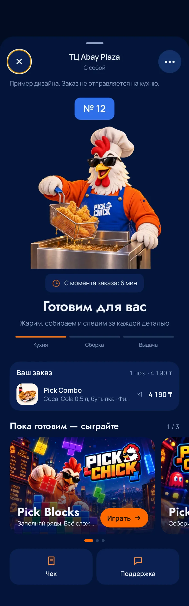 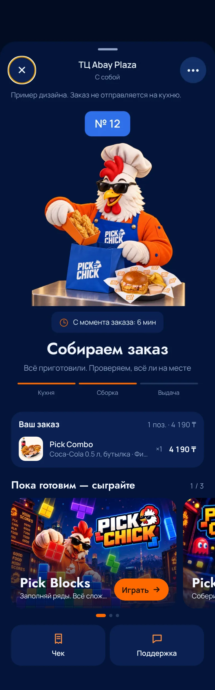 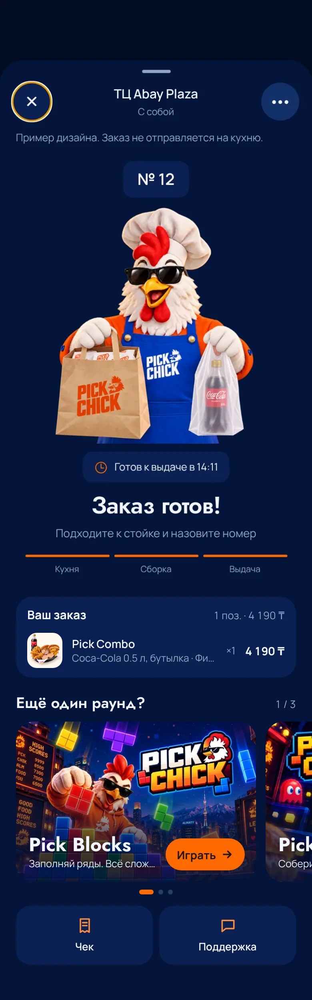
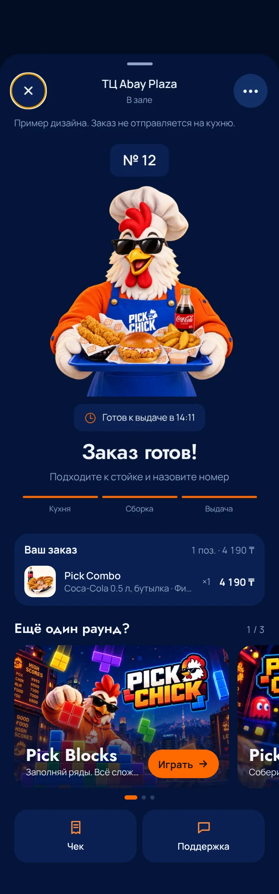 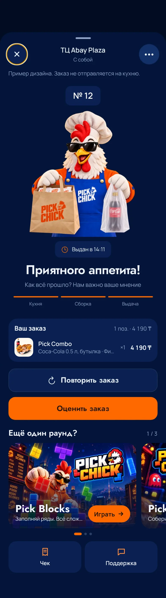

Было (вся страница): 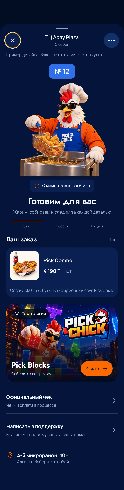 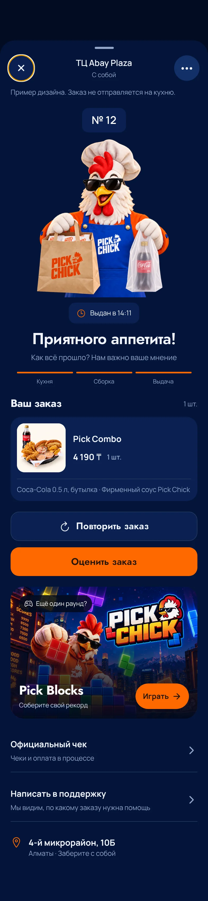

**Верх трекера оставить как есть**: шапка шторки (закрыть, ресторан, способ, «…»),
номер, сцены шефа `OrderChef` (cooking / assembly / ready — поднос для зала /
ready-takeaway — пакеты для «с собой»), crossfade 240 ms, плашка времени,
заголовок, подзаголовок, три этапа. На этапе «Выдан» кнопки «Повторить заказ»
и «Оценить заказ» — как есть.

Меняется низ (поля 20 pt):
1. **«Ваш заказ»** — компактный блок `#0A2050` радиус 20: заголовок «Ваш заказ» (15/700)
   и справа «1 поз. · 4 190 ₸»; строки: фото 44×44 (радиус 12), название (14/600),
   допы одной строкой с многоточием (12.5, вторичный), «×1», цена. Вместо
   большой карточки с фото 120 pt.
2. **Карусель игр** вместо одного баннера Pick Blocks. Заголовок «Пока готовим — сыграйте»
   (до выдачи) / «Ещё один раунд?» (готов/выдан), справа счётчик «1 / 3».
   Горизонтальный `FlatList`/`ScrollView` с `snapToInterval` 312 (карточка 300×200, gap 12,
   поля 20), видна часть следующей карточки. Карточка: обложка игры на весь фон
   (`cover`), снизу **плавный градиент** от прозрачного к `rgba(4,20,58,.92)` на 120 pt —
   **никакой сплошной тёмной плашки**; название (Jost 700, 24, тень), описание одной
   строкой, кнопка «Играть →» (40 pt, оранжевая). Под каруселью точки
   (активная 18×6 оранжевая, остальные 6×6 `#2A3E66`).
   Игры — только доступные: Pick Blocks, Pick Man, Magic Sort (обложки и тексты из
   их карточек на «Событиях»; доступность — `usePublishedContent(...).gameEnabled`).
   Pick Farm появится, когда будет включён флаг.
3. **«Чек» и «Поддержка»** — две плитки в ряд (`#0A2050`, радиус 18, иконка оранжевая
   над подписью). Заменяют строки «Официальный чек» и «Написать в поддержку».
4. **Убрать** строку с адресом точки / маршрутом внизу трекера.

---

## Проверка перед сдачей

- typecheck, lint, `pnpm test:mobile`, существующие тесты статусов/истории.
- Скриншоты web-сборки 393×852 всех экранов из этого документа (включая
  2 активных заказа, отменённый, 5+ позиций, пустую историю, закрытый ресторан)
  и сравнение с `images/`.
- Reduce Motion: сцены переключаются без анимации, карусель листается.
- Обновить `docs/project-status.md` и roadmap по правилам `AGENTS.md`.

Открытые вопросы к владельцу (не блокируют UI):
- Какая карта в приложении: 2ГИС SDK (ключ) или системная.
- Часы работы по дням недели — сейчас в конфиге одни на все дни.
