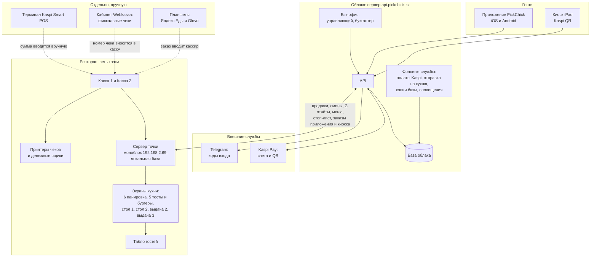
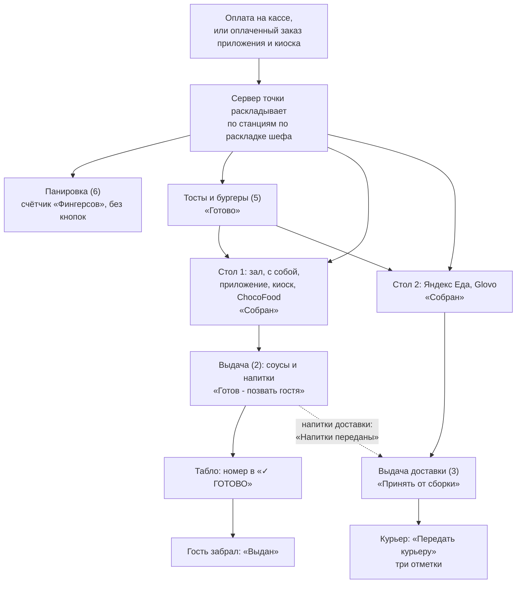
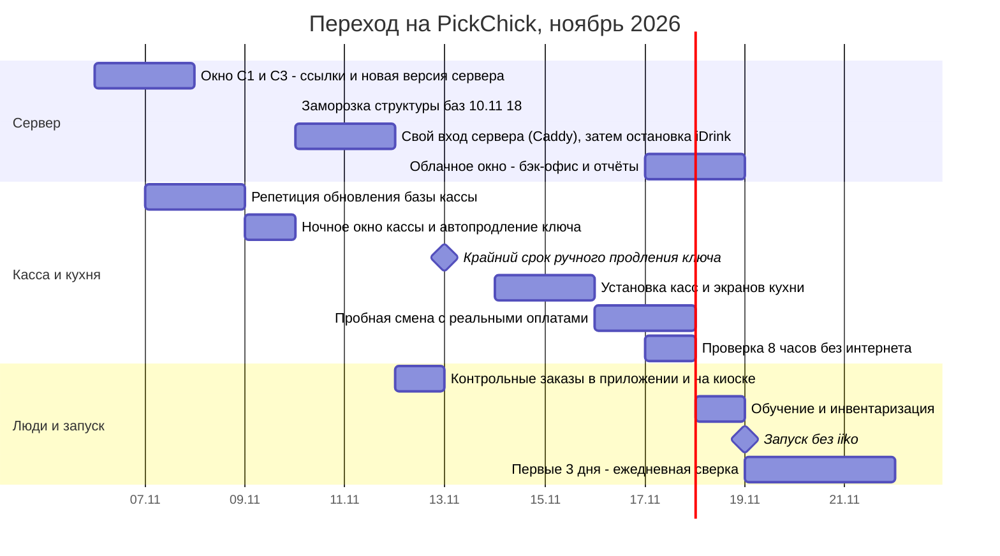

# Схемы PickChick

С 19.11.2026 ресторан работает только на PickChick, iiko выключается. Ниже - целевая схема системы на день запуска, путь заказа по кухне, календарь перехода и кто за что отвечает. Версия от 06.11.2026.

Схемы нарисованы на Mermaid: GitHub показывает их картинками прямо на этой странице.

## 1. Как устроен PickChick на 19.11

Две площадки: облако на сервере в интернете и сервер точки в сети ресторана. Касса и кухня работают через сервер точки, поэтому продают и готовят и без интернета. Облако отвечает за приложение, киоск, оплату Kaspi, бэк-офис и отчёты.

Что работает без интернета: обе кассы, экраны кухни, табло, печать чеков. Что требует интернета: приложение, киоск, оплата Kaspi Pay, бэк-офис, отправка продаж в отчёты (она догонит, когда связь вернётся).

## 2. Путь заказа по кухне

Заказ попадает на экраны только после оплаты. Каждая станция видит свою часть заказа. Весь заказ целиком, с напитками и соусами, видит только выдача (2). Подробно - в [памятках по станциям](pamyatki-po-stanciyam.md).

Правило отмены: пока на кухне не нажата ни одна кнопка по заказу, кассир может его отменить. После первой нажатой кнопки - только возврат через начальника смены.

## 3. Календарь перехода

Сроки из трекера «Запуск PickChick» на 06.11.2026. Точные даты окон назначает владелец.

20.11.2026 в 12:34 истекает ключ кассы, если его не продлить. Без продления онлайн-заказы перестанут доходить до кухни.

## 4. Кто за что отвечает

| Кто         | За что отвечает                                                                                        |
| ----------- | ------------------------------------------------------------------------------------------------------ |
| Владелец    | Решения, входы в аккаунты (Kaspi, Apple, Google, iiko, Webkassa), деньги, «да» на каждое окно и выпуск |
| Codex       | Сервер, установка на точке, отправка веток в GitHub, сборки приложений, магазины по «да» владельца     |
| Claude      | Код и его проверка техлидом, сведение веток, документы и памятки, трекер «Запуск PickChick»            |
| Управляющий | Персонал, смены, склад, расстановка, ответы на вопросы «уточнить у управляющего»                       |
| Бухгалтер   | Сверка денег и чеков, отчёты, решения по чекам Webkassa                                                |
| Персонал    | Работа по памяткам после обучения 18.11                                                                |
