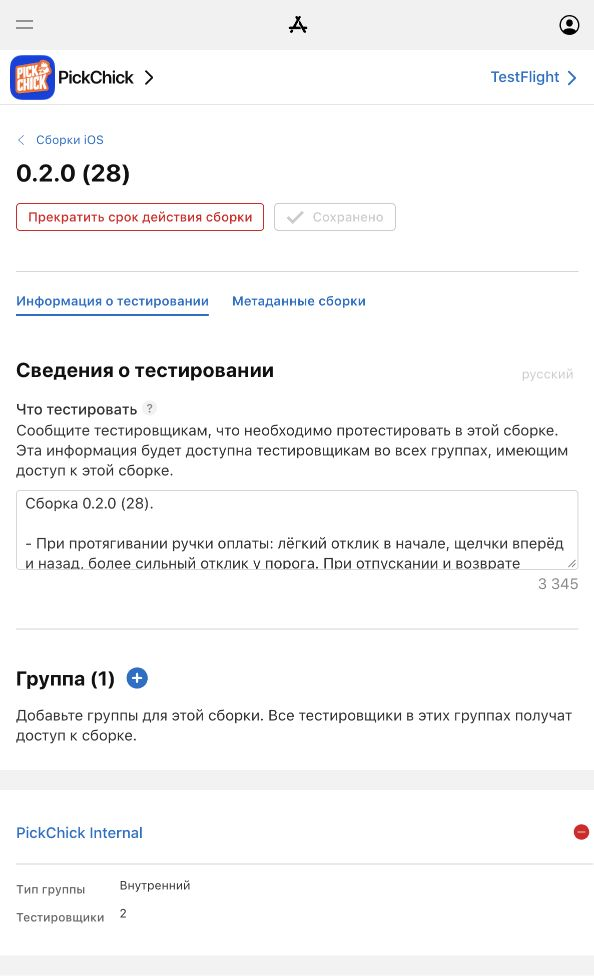

# PickChick 0.2.0 (28) - storefront и тактильный отклик

## Выпуск 29 октября 2026

Сборка **0.2.0 (28)** опубликована в **PickChick Internal**, 2 тестировщика.
Apple build `ad423d88-4f63-4a24-a342-2c5de7be2fa1`, описание сохранено.
[PR291](https://github.com/xaaknazar/pickchick/pull/291), merge `6c6fec0f`.
[Полная Foundation CI: 11/11](https://github.com/xaaknazar/pickchick/actions/runs/40879127804)
для исходника IPA `43ae6b042d68755c8ae50c8c10d9c0c40ce1cf67`.
[Машинное доказательство](mobile-testflight28-evidence.json).

## Подготовка

Единое поручение владельца: бандл c333144f от c36287e7. Shared 6660ce98
(включает TestFlight 27, PR289) влит обычным merge без конфликтов.
Только согласованные пересечения переданы из mobile-launch-1028,
mobile-appstore-1022 и kiosk-apple-demo. Прочие резервы сохранены.

Поведение: [очистка](mobile-redesign-2026-10-27/fix-store.md) и
[вибрация](mobile-redesign-2026-10-27/fix-haptics.md).
Версия 0.2.0, build 28, storefront, прежние backend и подпись.
EXPO_PUBLIC_UPCOMING_PAYMENTS не задаётся; expo-haptics требует новых prebuild/pods.

## Проверки

На выпускающем Mac 557 Node + 59 Python PASS. Установка frozen-lockfile PASS.
Workspace build/typecheck, ESLint, Prettier и переводы PASS.
Storefront browser_store_walk: 97 экранов PASS; browser_review_account: RU/EN/KK,
нет счёта и повторов, демонстрация и перезапуск PASS (изолированные фикстуры).
Expo prebuild и pod install PASS, ExpoHaptics 57.0.3 присутствует в Podfile.lock.
Doctor подтвердил прежнюю схему, Bundle ID, Team и подпись без изменения настроек.
Свайп A-Q PASS после чистого QA-экспорта. Первый запуск использовал кеш
предыдущего storefront-экспорта и не нашёл тестовый товар; код не менялся.
7 тестов roadmap PASS. Проверки CI-разбиения: 5 PASS; release guards: 54 tests,
4 platform skips, остальных ошибок нет. Полный operations-набор на Mac:
568 tests, 2 failures +4 errors в backup_offsite/client_ip_gateway, 14 skips;
это не зелёный полный локальный прогон, результат Ubuntu CI фиксируется отдельно.
Полная Foundation CI, архив, export, upload и назначение группы подтверждены.
Физическая приёмка не подтверждена. Подключён iPhone 17 Pro Max / iOS 27.0.1,
после ожидания CI Mirroring снова запросил пароль Mac. Владелец взял проверку
на себя и сообщил о работающем приложении и поступающих оплатах Kaspi.
Вибрация есть, но он просит сильнее/чаще. На первом входе в Pick Man из статуса
заказа шапка ушла под системную строку; повторный вход исправляет положение.
Эти замечания переходят в следующую задачу, приёмка не объявляется завершённой.
Владелец отдельно поручил сразу публиковать в TestFlight: upload начат до
окончания CI; назначение группы выполнено после зелёной CI и merge.
Нативный модуль подтверждён символом `_TtC11ExpoHaptics13HapticsModule` в
исполняемом файле. Подпись codesign --deep --strict PASS, флага UPCOMING_PAYMENTS
в архивном окружении нет. IPA 131638071 bytes; SHA256:
`223f1e52a09b4173af827242c4dfa8c6070e8b223d281a6e8733aa5616c96dea`.
Apple сообщила предупреждение о недостающем dSYM hermesvm.framework;
загрузка успешна, но символика сбоев Hermes может быть неполной.
Первый workspace typecheck потребовал сборки зависимостей; повтор после build.

CI run40873334637: account suite превысила лимит 25 минут после добавления
двух обходов магазина. Проверки перенесены в foundation_mobile (до переноса
254 секунды), покрытие сохранено. Попытка создать шестую foundation suite
выявила жёстко закреплённый набор jobs в выпускных guards других приложений;
он сохранён без изменения. Новые сценарии - отдельный шаг существующего
обязательного mobile job. Повторный полный прогон 40879127804 - PASS.

## Прод: только чтение

- GET availability: enabled=true, orderingOpen=true, часы 10:00-00:00 Asia/Almaty.
  Это 05:00-19:00 UTC; 28/29 октября 22:00-12:00 PDT. После 1 ноября 21:00-11:00 PST.
- GET notifications/config и customer-checkout/combo-rewards вернули HTTP404,
  поэтому ожидаемые внешние JSON не подтверждены. Внутренний API на VPS:
  notifications/config -> enabled=false, providers=[]; combo-rewards ->401 без
  сессии. Штатная установленная функция comboProgramOptions(process.env) ->null,
  то есть акция выключена. Переменных APNs/push нет. Публичные маршруты не менялись.
- API c3a0fbeea69e3c94b4a0994f5cdee74ba98c77da healthy.
  CUSTOMER_REVIEW_ACCOUNT_ENABLED=true, номер и digest настроены (не публикуются).
- Штатный app-review-access.py source23860557, без --apply:
  validated=true, applied=false, customer_collision=true. Это существующий
  настроенный review-профиль; нормализованный приватный номер и digest кода
  совпадают с runtime. Preflight не выполняет вход и не доказывает UI-вход.
- В установленном packages/commerce-core/dist/customer-checkout.js подтверждено
  fiscalPolicy: deferred_pilot для мобильного заказа.

## App Store: только чтение

Заявка 99775be3-3644-4d17-8e4f-ab4dfe3e53ca: Waiting for Review.
Версия 1.0 со сборкой 23 ожидает проверки; выпуск ручной.
Username содержит код страны +7, тогда как новый черновик предполагает 10 цифр.
Поля контакта и пароля заполнены, значения не публикуются.
Сохранённые заметки описывают прежний путь Sign in; они не обновлялись.
Описание и рекламный текст RU/EN без Apple Pay, «скоро», Чиков, draft и 7 + 1.
Отдельного поля «Что нового» у первой версии 1.0 нет.
Скриншот 01-menu.png содержит «Чики за любимый вкус» и «6 вершин Алматы · скоро».
02-pick-combo.png показывает старую цену 90 ₸. 03-restaurants.png без
перечисленных заглушек. Изображения не менялись.
Подготовлены [новые заметки](mobile-review-notes-28.en.txt) без секретов и без
непредоставленного видео. Pacific указан для 29 октября, перед подачей после
1 ноября его нужно заменить на 21:00 предыдущего дня - 11:00 PST.

## Ограничения

Не выполнять App Review submission, замену сборки23, ответы Apple, VPS/кассу/iPad,
реальные оплаты и публикацию онлайн-пульта. Для них нужен отдельный запрос владельца.
Владелец сообщил об ощущаемой вибрации, попросив усилить её. Полная проверка
всех сценариев на iPhone агентом не выполнялась; реальные оплаты агент не
проводил. Онлайн-пульт не обновлён.
