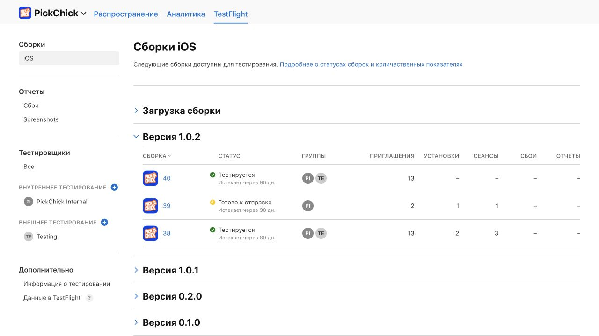

# PickChick TestFlight 40 - падение башни при уходе в сторону

## Разрешение и исходник

Владелец 17.11.2026 поручил выпустить исправление PR395 только в прежние
группы TestFlight. Публичный App Store, App Review и Google Play не входят в выпуск.

Основа - `9e216931d06e3e959215f120fbdf394d67d32f42`, слияние PR395 в
`codex/cutover-1119`. Ancestry подтверждена. Бинарный кандидат ветки
`codex/mobile-build40-1117` - `502743ce48dd2e96449bc3db15f836895cbad2b0`.
Поверх основы меняется только `apps/mobile/app.json`, `ios.buildNumber` 39 -> 40.
Версия 1.0.2, Bundle ID `kz.pickchick.app`, Android versionCode 11 сохраняются.

[Причина, модель и проверки](pick-box-balance-1116.md): теперь вес над каждым
стыком учитывается и после закрепления коробки. Постепенный уход вбок вызывает
направленную подсказку, крен и падение. Одна кривая коробка по-прежнему перестаёт
влиять через 5-6 ровных. Порог физической приёмки на iPhone ещё не подтверждён.

## Проверки

625 Node и 96 Python mobile tests, TypeScript приложения и зависимостей,
ESLint, Prettier, production web-export - PASS. Семь тестов roadmap и ссылки
итогового протокола также прошли. Зависимости установлены по
frozen lockfile. Профиль подписи совпадает с 39 по SHA-256.

[Foundation CI 44041220661](https://github.com/xaaknazar/pickchick/actions/runs/44041220661)
на точном SHA кандидата - 11/11 PASS, попытка 2, до upload. Первоначальная попытка
остановила задание `Foundation server account and Kaspi fixtures` в
`tests/mobile/browser_launch_resume.py`, `scenario_not_closed`, `banner_geometry`.
Измерение сразу после восстановления: низ напоминания 764, верх корзины 698.
Упавший сценарий B (393/320) и полный набор ABCDEFGH локально прошли без
изменения кода и утверждений. Все остальные задания первой попытки прошли.
17.11 точечный повтор задания аккаунта прошёл; итоговая проверка также PASS.
Код и утверждения тестов не менялись. Загрузка началась только после полного PASS.

Archive, export и upload завершены: версия 1.0.2, build 40, Bundle ID, production,
`https://api.pickchick.kz`, dirty=false, отсутствие `.appex`, прежний профиль
и восстановление временных настроек подписи подтверждены.
`EXPO_PUBLIC_UPCOMING_PAYMENTS` не задан. События backend для archive/export
и upload без warning, `profile_from_default=false`. Apple приняла upload.

IPA: `~/Library/Caches/PickChick/releases/mobile-pick-box-20261117-40/export/PickChick.ipa`,
134748264 байт; SHA-256:
`0dfa2a16d277d5f188d4f07c0b2ef5b59e2dcdd7e976614a8b47f048506e96f0`.
Хеш относится к export. После archive исправлено только имя приватной папки
артефактов с суффикса 39 на 40; байты архива не менялись, исходный журнал сохранён.

## Доставка и ограничения

Apple обработала 1.0.2 (40), Build ID `abae2dc0-8251-44f1-b739-5feb8ea4b59f`.
В TestFlight статус «Тестируется», назначены PickChick Internal (2) и Testing (11),
в общей строке 13 приглашений. Русское «Что тестировать» сохранено, автоматическое
уведомление включено. Для внешней группы выполнено действие «Отправить на проверку»
в TestFlight; после него наблюдалась строка «Тестируется» с обеими группами.
Это бета-проверка TestFlight, публичный App Review не менялся.

При upload Xcode предупредил об отсутствующих dSYM восьми сторонних framework
(ExpoImage, React, ReactNativeDependencies, SDWebImage и три его кодека, hermesvm).
Загрузка принята; предупреждение ограничивает расшифровку сбоев в этих библиотеках.
Это отдельные предупреждения Xcode, события backend во всех трёх фазах без warning.
[Машиночитаемые подтверждения](mobile-testflight40/release-evidence.json).

[PR397](https://github.com/xaaknazar/pickchick/pull/397) - обычная интеграция в cutover.
После upload включён принятый cutover `7e7911ee` (PR396) обычным merge `d36493e3`.
Исходники `apps/mobile` побайтно совпадают с бинарным `502743ce`; происхождение IPA
не меняется. Изменение инструмента выпуска в PR396 относится к киоску и не входило
в уже загруженный архив 40. Публичный App Store, App Review, Google Play и серверы
этим мобильным выпуском не изменялись. Онлайн-пульт не публиковался.
Foundation принятой основы `7e7911ee` также прошла:
[44042582924](https://github.com/xaaknazar/pickchick/actions/runs/44042582924).

## Что тестировать

Pick Box: башня, которая уходит в одну сторону, теперь кренится и падает. Под счётом
появляется подсказка "Крен вправо - ставь левее": верните коробки к середине башни, и она
устоит. Одна кривая коробка по-прежнему забывается через несколько ровных.

## Физическая приёмка

Владелец проверяет на iPhone:

- Постепенно ставить правее: после 15-20 коробок появляется крен вправо, подсказка и вибрация.
- Продолжить вправо или на том же месте: башня качается и падает в сторону крена.
- В новой попытке вернуть верх левее к основанию: подсказка гаснет, можно строить дальше.
- Высокая башня 60-90 коробок над основанием стоит как раньше.
- Одна кривая коробка и 5-6 ровных успокаивают башню.
- Башня не уходит за край экрана.

## Откат

Тестировщик выбирает прежнюю 1.0.2 (39) в TestFlight. При подтверждённой
проблеме 40 можно снять с тестовых групп без изменения серверов и публичной версии.
